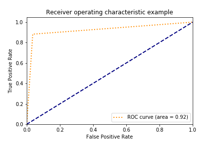

# Predicting Relapse in Addiction Treatment Patients

An end-to-end machine learning project (my MSc project, 2020) that predicts relapse / treatment dropout among patients in addiction treatment, so that high-risk patients can be identified early and given extra support.

I built the dataset myself from clinical records, engineered the features, and designed and evaluated the models.

## Data

- 424 patient records, ~48 features after processing
- Feature groups: demographics (gender, age group, education, marital status, occupation, income); substance profile (opium, tobacco, methadone, buprenorphine, age of first use, years of use, daily use cost); history (previous treatment dropout, anxiety, depression, aggression, mental illness); family context (family problems, family emotional support); treatment process (treatment duration, number of counseling sessions, physician visits)
- Target: relapse — 57 positive vs 367 negative (imbalanced, ~13%)
- Treatment dates were recorded in the Jalali (Persian) calendar and converted with `jdatetime`; treatment duration was engineered from start / last-visit dates

> **Privacy:** the dataset contains real patient records and is **not** included in this repository. The code expects a local `dataset.xlsx` file.

## Pipeline

- Missing data: iterative imputation (`IterativeImputer`), median imputation as fallback
- Scaling: `StandardScaler`
- Feature selection: `SelectKBest` (f_classif, k = 35)
- Class imbalance: SMOTE oversampling and class weighting
- Evaluation: stratified 70/30 train/test split — accuracy, recall, precision, F1, confusion matrix, ROC/AUC

## Models

- **Stacked ensemble (main model):** 100 decision trees (entropy criterion, class-weighted), each trained on random feature/row subsets; their predictions feed a Multinomial Naive Bayes meta-classifier. A hand-tuned rule-based combiner merges the SMOTE and non-SMOTE variants.
- **Benchmark:** class-weighted Random Forest (200 trees), analysed with feature importance, permutation importance (30 repeats) and ROC curves.

## Results (held-out test set)

| Model | Accuracy | Recall | Precision | F1 |
|---|---|---|---|---|
| Stacked decision-tree ensemble | **0.953** | **0.882** | 0.789 | **0.833** |

Strongest predictors: treatment duration, number of counseling sessions, physician visits, opium use, years of use, age of first use, previous treatment dropout, and absent family emotional support.

## Files

- `Zokaie.ipynb` — main analysis notebook (modelling, Random Forest, feature importance, ROC)
- `MyFunctions.py` — reusable pipeline and the stacked-ensemble implementation (`test_model`)
- `my_first_attack.py` — script version that trains the SMOTE / non-SMOTE variants and combines them
- `roc.png` — ROC curve figure

## Tools

Python, pandas, NumPy, scikit-learn, imbalanced-learn, jdatetime, matplotlib

## Author

Zahra Zokaei — [LinkedIn](https://www.linkedin.com/in/zahra-zokaei/)
